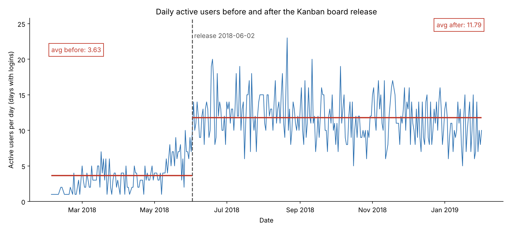
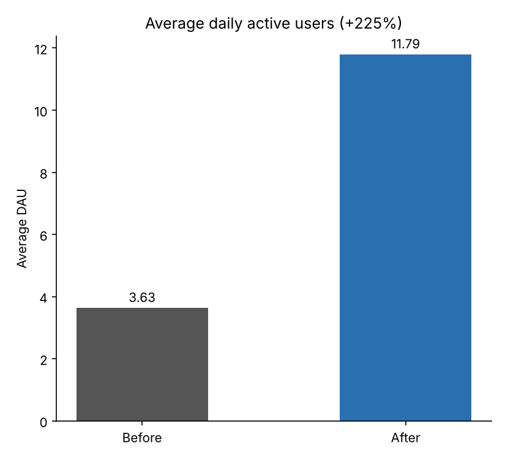
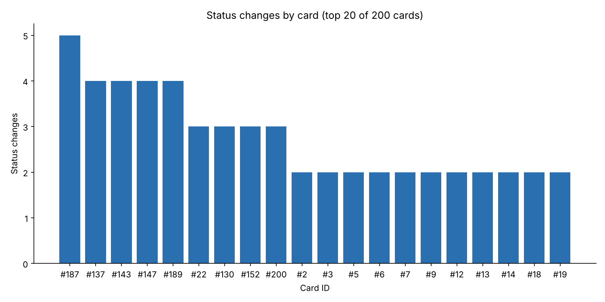
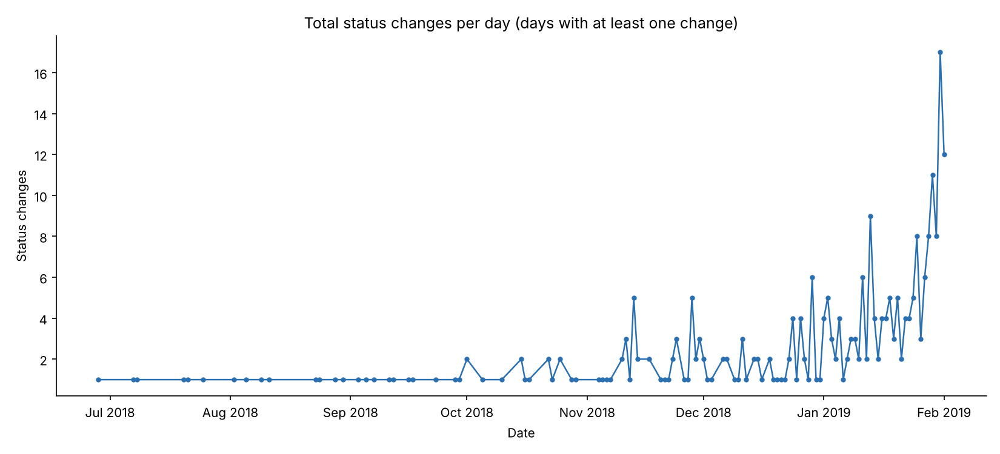

# Shiptivitas Task 3 – Analyzing the Kanban Board Release

## What I did

I took the SQLite database from the repo (`shiptivity.db`) and wrote SQL queries to find:
1. daily active users (DAU) before and after the Kanban board release
2. the number of status changes per card (and per day)

The README says the board was released on **2018-06-02**. The `card_change_history` table also starts on that same day, so I used it as my cut-off date. All the timestamps are in unix seconds, so I used `date(x, 'unixepoch')` to turn them into dates.

All my queries are in `queries.sql`.

---

## 1. Daily active users before vs after





| Period | Days | Avg DAU |
|---|---|---|
| Before (2018-02-03 to 2018-06-01) | 110 | 3.63 |
| After (2018-06-02 to 2019-02-01) | 245 | 11.79 |

Average DAU went from about 3.6 to about 11.8, which is roughly 3x higher. The highest day was 23 users on 2018-08-21.

Some things I noticed:
- DAU was already going up a bit in May, before the release (around 5–9 a day), so not all of the jump is from the board. The before period also starts really low (1 user a day in February).
- After the jump, DAU stays flat at around 10–15 a day all the way to January. It doesn't keep growing.
- There are 100 users in total, so even after the release only about 12% of users are active on a normal day.
- 9 days have no logins at all, so they don't show up in the table. If I count them as 0, the before average drops to 3.35. The after average doesn't change.

## 2. Status changes by card





I didn't count the first row for each card (where `oldStatus` is NULL), because that's just the card being created and not a real move.

- 200 cards, 286 real status changes
- backlog → in-progress: 167
- in-progress → complete: 103
- in-progress → backlog: 11
- complete → in-progress: 5
- 38 cards never moved at all, and most cards moved only once or twice. The most any card moved was 5 times (card #187).
- Card activity started very slow (only 1 move in June) and then picked up a lot. January 2019 had 149 moves, more than all the other months together.

The interesting part is that card moves went way up in January but DAU stayed about the same. So it looks like the same people are using the board more, not new people coming in. Only about half of the cards that got started (103 of 167) actually reached "complete", and 38 cards just sit in the backlog.

---

## 3. Three feature ideas

### Idea 1: Notifications and due-date reminders

**Hypothesis:** Users only log in when they remember to. If we notify them when a card they own changes status, or when a card is close to its due date, more of them will come back every day.

**Expected impact:** Higher DAU and better retention. I'd measure DAU, how many logins come from a notification click, and 7-day / 30-day retention. Right now only ~12 out of 100 users log in on a normal day, so there is a lot of room to grow.

**What the feature is:** Email (and later push) notifications when:
- a card assigned to you moves to a new status
- someone comments on or assigns you a card
- a card is due in 24 hours (and you can change the timing)

Plus an optional morning summary email that says "you have 3 cards in progress, 1 due today". Users can turn each one on or off in settings.

Why I think this would work: Trello said custom due-date reminders were one of their most requested features ever ([Atlassian blog](https://www.atlassian.com/blog/trello/custom-due-date-reminders)). A study of 39M+ mobile users also found 90-day retention of about 28% with push notifications vs 10% without ([MarTech](https://martech.org/mobile-app-push-notifications-drive-90-day-retention-rates-by-as-much-as-180)).

```
 ┌───────────────────────────────┐
 │ 🔔 Shiptivitas                │
 │ Card #187 "Order 4521" moved  │
 │ In-progress → Complete        │
 │ by Alex · 2 min ago  [Open]   │
 └───────────────────────────────┘
```

### Idea 2: Bulk actions on cards

**Hypothesis:** Shipping teams handle lots of orders at the same time. Moving cards one by one is slow, so people put off updating the board. That could be why 38 cards never moved and why the board gets updated in bursts (like at the end of January). If they can move many cards at once, they'll keep the board up to date every day.

**Expected impact:** More status changes per active user, fewer cards stuck in backlog, and less time spent updating. I'd measure moves per user per day, the % of cards that reach "complete", and how many users try the bulk action in the first month.

**What the feature is:** Tick checkboxes on cards (or shift + click), and a toolbar shows up with:
- Move to → Backlog / In-progress / Complete
- Assign to a person
- Set due date / priority

Trello users asked for this for a long time ([Jira TRELLO-128](https://jira.atlassian.com/browse/TRELLO-128)). When Trello added it, people asked for more bulk options straight away. One thing to watch: Trello's first shortcut clashed with the browser's "open in new tab", so we should test the shortcut.

```
 [✓] 3 cards selected   [Move to ▾] [Assign ▾] [Priority ▾] [x]
 ┌ Backlog ─────┐ ┌ In-progress ─┐ ┌ Complete ────┐
 │ [✓] Order 12 │ │ [ ] Order 8  │ │   Order 3    │
 │ [✓] Order 14 │ │              │ │              │
 │ [✓] Order 15 │ │              │ │              │
 └──────────────┘ └──────────────┘ └──────────────┘
```

### Idea 3: Cards that update themselves from carrier tracking

**Hypothesis:** If the board is always correct without people having to update it by hand, it becomes the place people check every morning to see where their shipments are. That should bring in users who don't move cards themselves but want to know the status (managers, sales, support).

**Expected impact:** Higher DAU, especially from people who only view the board. I'd measure DAU, DAU/MAU (a normal B2B SaaS number is about 25–35% according to [Mixpanel](https://mixpanel.com/blog/mau/)), and the % of cards updated automatically.

**What the feature is:** When a user adds a tracking number to a card, we connect to the carrier (UPS, FedEx, DHL etc.) and:
- move the card to "In transit" when the carrier picks it up
- move it to "Complete" when it's delivered
- add a red "Delayed" tag if the carrier reports a problem, and notify the card owner (this links to Idea 1)

There's a real need for this. In one industry survey only about 1 in 5 shippers said they get enough shipment visibility from their logistics providers ([Tive / FreightWaves](https://www.tive.com/content/survey-report-shippers-dissatisfied-by-lack-of-shipment-visibility)).

```
 Card: Order 4521                    [Tracking: 1Z999AA1...]
 Status: In transit  (auto-updated from UPS · 9:14am)
 ⚠ Delayed – weather in Memphis. Owner notified.
```

---

## Next steps

- Run each idea as an A/B test if we can, because the before/after DAU jump could partly be the novelty effect or the growth that was already happening in May.
- Track feature adoption: (users who moved a card) ÷ DAU, week by week.
- Look at the support tickets to check which of these ideas customers actually ask for most.

## Files
- `queries.sql` – all SQL queries
- `charts/` – graphs
- `results/` – query outputs as CSV
